# Study Diary – Week 4: Databases and Data Persistence

---

## 1. Theory

**What is data persistence?**
Data persistence means the data is still there after the program stops. If I save something today, I can read it back after a restart, a crash or even a reboot, because it was stored on disk and not only in the program's memory.

**Why is a JavaScript array not normally suitable as the primary storage for a backend?**
The array only exists in the RAM of the running Node.js process, so everything is lost every time Express restarts or crashes. I also can't share it between several servers, and it has no rules that stop bad data from getting in. That was fine for practising Express in Week 3, but not for a real application.

**What is the difference between a database and a DBMS? Which one is PostgreSQL?**
The database is the actual collection of data, for example my `backend_course` database with the `movies` table. The DBMS is the software that stores and manages databases and runs queries against them. PostgreSQL is a DBMS (a relational one), and `backend_course` is one database inside it.

**When could a JSON file be a reasonable storage solution? Two limitations in a multi-user backend?**
A JSON file is OK for small things that rarely change, like configuration, seed data or a quick prototype that only one person uses. In a backend with many users it has problems:
- If two requests write to the file at the same time, one of them can overwrite the other and data gets lost.
- The whole file has to be read and written again for every change, so it gets slow when the data grows, and there are no indexes, queries or constraints.
- If the server crashes in the middle of writing, the file can end up broken.

**Relational vs document database (example of each)?**
A relational database stores data in tables with fixed columns and connects tables with keys, and you use SQL to query it. Example: PostgreSQL. A document database stores JSON-like documents, and documents in the same collection don't need to have the same fields. Example: MongoDB.

**Terms**
- **Table**: a collection of data about one kind of thing, like `movies`.
- **Row**: one record in the table, like the movie *Inception*.
- **Column**: one property that every row has, with a data type, like `title VARCHAR(200)`.
- **Schema**: the structure of the database, meaning which tables, columns, types and constraints exist.
- **Primary key**: the column that identifies each row uniquely. It can't be empty or repeated. In my table it is `id`.

**What is a foreign key and what problem does it solve?**
A foreign key is a column that points to the primary key of another table, for example `reviews.movie_id` pointing to `movies.id`. It makes sure the relationship stays valid: you can't add a review for a movie that doesn't exist, and you can't delete a movie that still has reviews (unless you use something like `ON DELETE CASCADE`). Without it you could end up with "orphan" rows that point to nothing.

**What is a constraint? Purpose of NOT NULL and PRIMARY KEY?**
A constraint is a rule that the database itself checks, so wrong data is rejected even if my application code forgets to validate it. `NOT NULL` means the column must always have a value, so a movie can't be saved without a title, director or year. `PRIMARY KEY` makes the column unique and not null, so every row can always be found by its id.

**What is a transaction? Example where all operations must succeed or fail together.**
A transaction puts several SQL statements together so they either all succeed (`COMMIT`) or are all cancelled (`ROLLBACK`). A typical example is a bank transfer: €100 is taken from account A and added to account B. If only the first step worked, the money would just disappear, so both steps have to be in the same transaction.

**What is an index? Why not index every column?**
An index works like the index at the back of a book. It lets the database find rows quickly without reading the whole table. But every index takes extra space and has to be updated on every INSERT, UPDATE and DELETE, so too many indexes make writing slower. It makes sense to index only the columns you search or sort by often.

**What is SQL injection? How do parameterized queries help?**
SQL injection happens when user input is glued straight into the SQL string, so the user can change what the query does. For example, `' OR '1'='1` can make a filter return every row, and something like `; DROP TABLE movies` could even delete the table. With parameterized queries I write `WHERE id = $1` and pass the value separately in an array, so PostgreSQL always treats the input as a value and never as SQL code. I tested this myself in test 22: the injection string just returned an empty list.

---

## 2. Database

**Setup**
- PostgreSQL 17 server, pgAdmin 4 and the command-line tools installed. User `postgres`, host `localhost`, port `5434` (not the default 5432, because other PostgreSQL versions are also installed on this machine).
- Database `backend_course` created and visible in pgAdmin under Servers → PostgreSQL 17 → Databases.

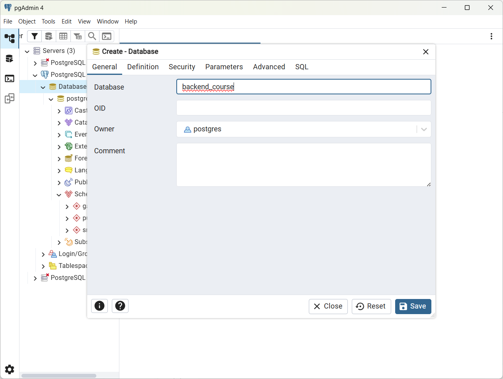

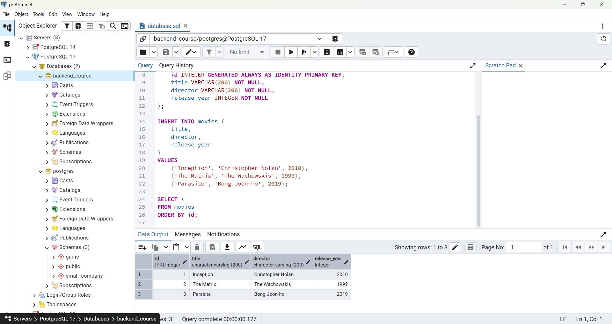

**Table structure** (`database.sql`)

```sql
CREATE TABLE movies (
    id INTEGER GENERATED ALWAYS AS IDENTITY PRIMARY KEY,
    title VARCHAR(200) NOT NULL,
    director VARCHAR(200) NOT NULL,
    release_year INTEGER NOT NULL
);
```

| Column | Type | Constraints |
|---|---|---|
| id | INTEGER | generated identity, PRIMARY KEY |
| title | VARCHAR(200) | NOT NULL |
| director | VARCHAR(200) | NOT NULL |
| release_year | INTEGER | NOT NULL |

**Initial rows**

| id | title | director | release_year |
|---|---|---|---|
| 1 | Inception | Christopher Nolan | 2010 |
| 2 | The Matrix | The Wachowskis | 1999 |
| 3 | Parasite | Bong Joon-ho | 2019 |

**SQL CRUD tests** (all in `sql-crud-tests.sql`)

Insert with `RETURNING *`:

```sql
INSERT INTO movies (title, director, release_year)
VALUES ('Arrival', 'Denis Villeneuve', 2016)
RETURNING *;
```

| id | title | director | release_year |
|---|---|---|---|
| 4 | Arrival | Denis Villeneuve | 2016 |

Update: `UPDATE movies SET release_year = 2017 WHERE id = 4 RETURNING *;` returned row 4 with `release_year = 2017`.
Delete: `DELETE FROM movies WHERE id = 4 RETURNING *;` returned the deleted row, and a final `SELECT` showed rows 1–3 again.

| Operation | Screenshot |
|---|---|
| Select all | 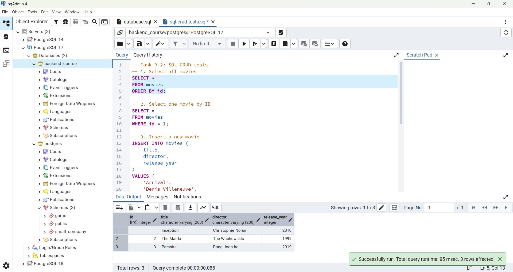 |
| Select by ID | 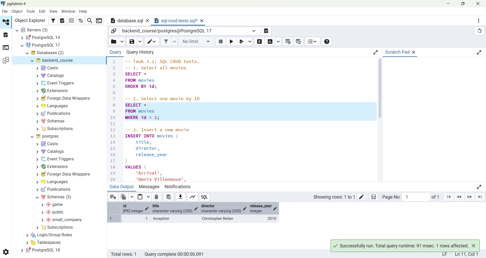 |
| INSERT … RETURNING * | 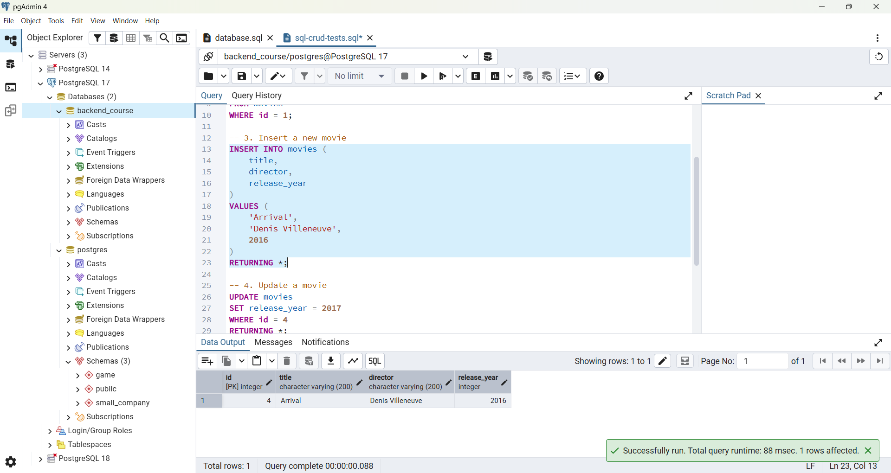 |
| UPDATE … RETURNING * | 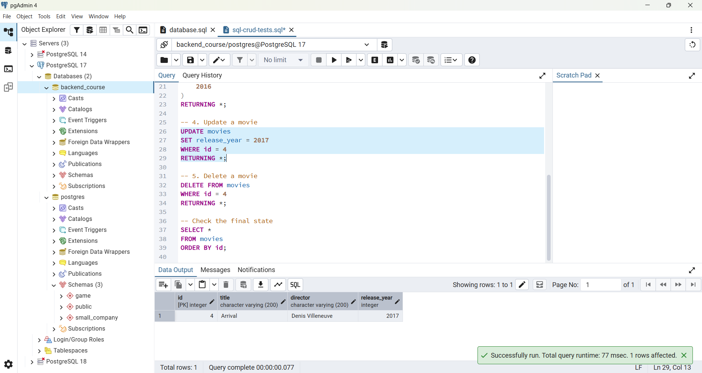 |
| DELETE … RETURNING * | 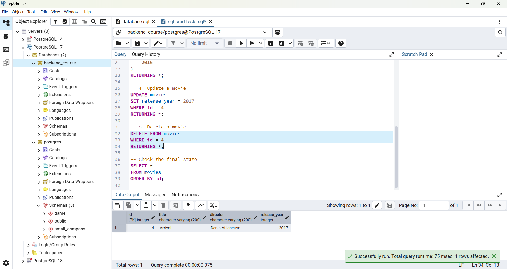 |
| Final state | 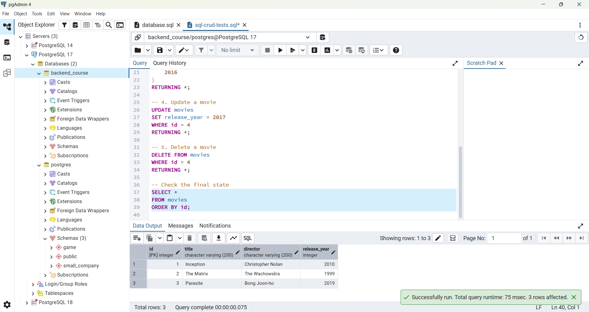 |

Note: the deleted row's id 4 is not reused. A later insert gets id 5, because an IDENTITY counter only moves forward.

---

## 3. Implementation

`TODO:` repository link: https://github.com/<your-username>/<repo-name>

**Files**
- `database.sql`: recreates and seeds the table
- `db.js`: exports a `pg` Pool configured from environment variables
- `app.js`: Express app. dotenv is loaded first, then the health endpoint, the six CRUD routes and the error middleware
- `.env.example`: safe placeholder values (`.env` itself is git-ignored)
- `requests.http`: REST Client tests

**Connection** (`db.js`)

```js
const pool = new Pool({
    host: process.env.PGHOST,
    port: Number(process.env.PGPORT),
    database: process.env.PGDATABASE,
    user: process.env.PGUSER,
    password: process.env.PGPASSWORD
});
```

`require("dotenv").config()` is the first line of `app.js`, before `require("./db")`, because the Pool reads `process.env` when it is created.

**GET one, parameterized query and 404**

```js
const result = await pool.query(
    `SELECT id, title, director, release_year AS year
     FROM movies WHERE id = $1`,
    [id]
);
if (result.rows.length === 0) {
    return res.status(404).json({ error: "Movie not found" });
}
res.json(result.rows[0]);
```

**Sorting with an allow-list.** Column names can't be `$1` parameters, so only server-defined names reach the SQL:

```js
const SORT_COLUMNS = { id: "id", year: "release_year", title: "title" };
const sortColumn = SORT_COLUMNS[sortBy];   // undefined -> 400 Bad Request
```

**PATCH with controlled dynamic SQL**

```js
for (const field of fields) {
    const column = allowedFields[field];      // never the client's string
    values.push(body[field]);
    setClauses.push(`${column} = $${values.length}`);
}
values.push(id);
// UPDATE movies SET title = $1, release_year = $2 WHERE id = $3 RETURNING ...
```

Empty bodies and fields that aren't in the allow-list are rejected with 400.

**DELETE**: `DELETE FROM movies WHERE id = $1 RETURNING id`. Returns 404 if no row came back, otherwise `res.status(204).end()` with no JSON body.

**Errors**: every async route wraps its `pool.query` in `try/catch` and calls `next(error)`. Centralized error middleware after all routes returns 400 for malformed JSON or PostgreSQL data/constraint errors, 503 when the database is unreachable, and 500 otherwise.

---

## 4. Testing and Reflection

**HTTP tests** (`requests.http`)

All requests were sent with the VS Code REST Client extension while `npm start` was running. The Express terminal (morgan) logged each request with its status code.

| # | Test | Expected | Result | Evidence |
|---|---|---|---|---|
| 1 | GET /health/database | 200, databaseTime | ✅ 200 | [screenshot](screenshots/10-http-01-health.png) |
| 2 | GET /movies | 200, JSON array | ✅ 200, 3 rows | [screenshot](screenshots/11-http-02-get-all.png) |
| 3 | GET /movies/1 | 200 | ✅ 200, Inception | [screenshot](screenshots/12-http-03-get-existing.png) |
| 4 | GET /movies/9999 | 404 | ✅ 404 | [screenshot](screenshots/13-http-04-get-missing-404.png) |
| 5 | GET /movies/abc | 400 | ✅ 400 | [screenshot](screenshots/14-http-05-get-invalid-id-400.png) |
| 6 | POST valid | 201, generated id | ✅ 201, id 4 | [screenshot](screenshots/15-http-06-post-201.png) |
| 7 | POST invalid (no director, year as string) | 400 | ✅ 400, two errors | [screenshot](screenshots/16-http-07-post-invalid-400.png) |
| 8 | PUT /movies/4 complete | 200 | ✅ 200, replaced with Dune 2021 | [screenshot](screenshots/17-http-08-put-200.png) |
| 9 | PUT /movies/4 without year | 400 | ✅ 400 | [screenshot](screenshots/18-http-09-put-incomplete-400.png) |
| 10 | PUT /movies/9999 | 404 | ✅ 404 | [screenshot](screenshots/19-http-10-put-missing-404.png) |
| 11 | PATCH title only | 200 | ✅ 200, director and year unchanged | [screenshot](screenshots/20-http-11-patch-200.png) |
| 12 | PATCH `{}` | 400 | ✅ 400 | [screenshot](screenshots/21-http-12-patch-empty-400.png) |
| 13 | PATCH `{"id":100}` | 400 | ✅ 400, not in allow-list | [screenshot](screenshots/22-http-13-patch-unknown-400.png) |
| 14 | DELETE /movies/4 | 204, no body | ✅ 204 | [screenshot](screenshots/23-http-14-delete-204.png) |
| 15 | DELETE /movies/4 again | 404 | ✅ 404 | [screenshot](screenshots/24-http-15-delete-again-404.png) |
| 16 | GET /movies/4 | 404 | ✅ 404 | [screenshot](screenshots/25-http-16-get-deleted-404.png) |
| 17 | ?director=christopher nolan | 200, Inception | ✅ case-insensitive match | [screenshot](screenshots/26-http-17-filter-director.png) |
| 18 | ?year=1999 | 200, The Matrix | ✅ | [screenshot](screenshots/27-http-18-filter-year.png) |
| 19 | ?sortBy=year | 1999, 2010, 2019 | ✅ | [screenshot](screenshots/28-http-19-sort-year.png) |
| 20 | ?sortBy=title&order=desc | The Matrix, Parasite, Inception | ✅ | [screenshot](screenshots/29-http-20-sort-title-desc.png) |
| 21 | ?sortBy=release_year;DROP TABLE movies | 400 | ✅ 400, rejected by the allow-list and table untouched | [screenshot](screenshots/30-http-21-bad-sort-400.png) |
| 22 | ?director=' OR '1'='1 | 200, [] | ✅ `[]`, the input was treated as a plain string | [screenshot](screenshots/31-http-22-injection-empty.png) |

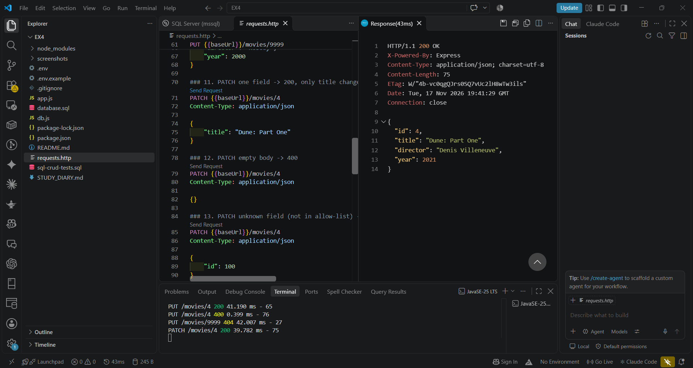

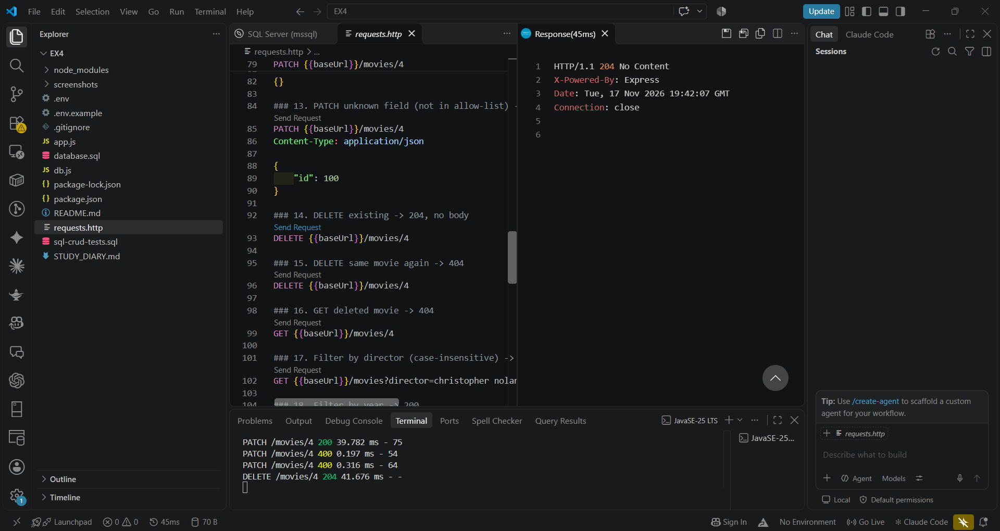

**Database evidence**: after POST, PUT, PATCH and DELETE, `SELECT * FROM movies ORDER BY id;` in pgAdmin showed each change: the new row 4, its replaced title and year, the patched title, and then the row gone.
After all the HTTP tests, pgAdmin shows exactly the rows the API left behind: the seed rows 1–3 plus row 5 created through `POST /movies`. Row 4 was created, replaced and patched through the API, then deleted, so it is gone. PostgreSQL never reuses its id.

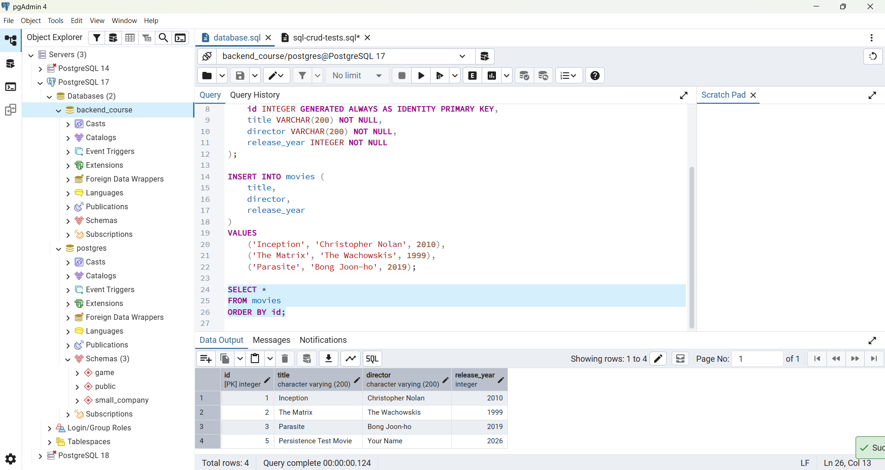

**Persistence test**
1. `POST /movies` with "Persistence Test Movie" → 201, id 5. ([screenshot](screenshots/32-http-23-persistence-post.png))
2. The row was visible in pgAdmin.
3. Stopped Express with Ctrl+C and started it again with `npm start`.
4. `GET /movies` still returned "Persistence Test Movie" (id 5).

The terminal shows a new `Server running on http://localhost:3001` line, which means the process was restarted. The first `GET /movies` after that still returns "Persistence Test Movie" with id 5.

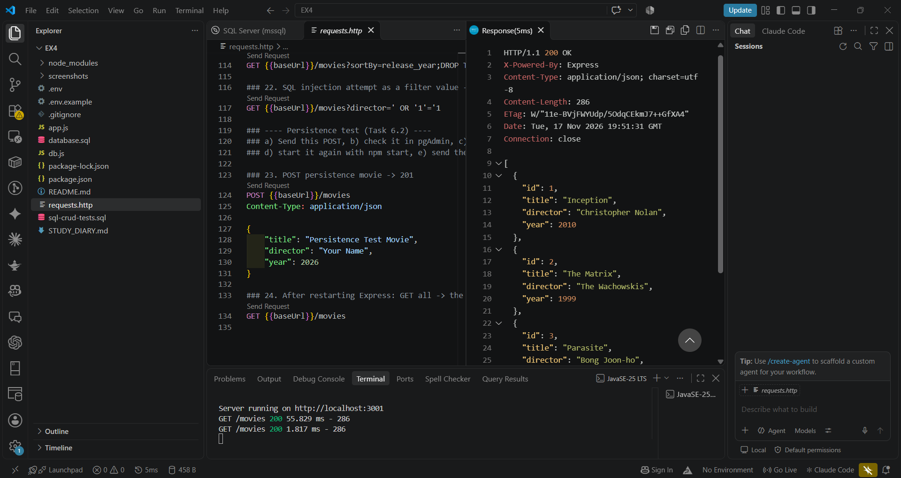

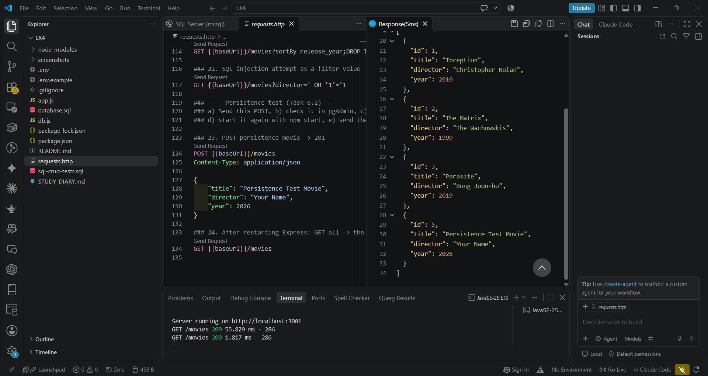

### Theory questions after the implementation

**Role of the `pg` package?**
`pg` (node-postgres) is the PostgreSQL client for Node.js. It opens connections to the server, sends SQL with its parameters, and returns the results as JavaScript objects (`result.rows`).

**What is a connection pool, and why is it useful in an HTTP server?**
A pool keeps a set of open database connections and lends one to each query, then takes it back. Opening a new connection for every HTTP request is slow (network handshake and authentication), and opening too many would overload PostgreSQL. A pool reuses connections, limits how many exist, and lets concurrent requests run queries in parallel.

**Why are the route handlers `async`?**
Database queries take time and return a Promise. Declaring the handler `async` lets me use `await` inside it, so the code reads top to bottom while Node.js stays free to handle other requests during the wait.

**What does `await pool.query(...)` do?**
It takes a connection from the pool, sends the SQL and parameter values to PostgreSQL, and pauses that handler (not the whole server) until the result arrives. It then returns the result object. If the query fails, the Promise rejects and the error is thrown into my `catch` block.

**`result.rows` vs `result.rows[0]`?**
`result.rows` is an array of every row the query returned, which is what `GET /movies` sends back. `result.rows[0]` is the first row as a single object, which is used when at most one row is expected, such as GET, PUT, PATCH or POST for a single movie. If no row matched, `rows[0]` is `undefined`, so `rows.length === 0` is checked first to return 404.

**Why `release_year AS year`?**
The database column is called `release_year`, but the Week 3 API returned `year`. The alias renames the column in the result, so the JSON stays `{ id, title, director, year }` and clients don't have to change.

**Why store credentials in `.env` and not in `app.js`?**
`app.js` is committed to Git and could end up public, so a password in it would be leaked. `.env` is git-ignored, stays on each machine, and can hold different values for development and production without changing the code. `.env.example` shows which variables are needed without real secrets.

**How do `WHERE id = $1` and `[id]` belong together?**
`$1` is a numbered placeholder in the SQL text, and `[id]` is the values array passed as the second argument to `pool.query`. node-postgres sends both to PostgreSQL separately, and PostgreSQL puts the first array element in place of `$1` as a value (`$2` would take the second, and so on). Because the value never becomes part of the SQL text, it can't be used for SQL injection.

**Which parts of the REST API stayed unchanged?**
The URLs, the HTTP methods, the request bodies (`title`, `director`, `year`), the JSON response shape, the status codes (200, 201, 204, 400, 404), validation through `validateMovie()`, and the filter and sort query parameters. Only the data layer changed, from array operations to SQL.

**What evidence showed the data was persistent?**
A movie created through `POST /movies` was still returned by `GET /movies` after Express was stopped and restarted, and it was visible as a row in pgAdmin the whole time. With the old array version, it would have disappeared on restart.

### What I learned
The most useful thing this week was seeing persistence with my own eyes. I added a movie, stopped Express with Ctrl+C, started it again, and the movie was still there, which never happened with the array in Week 3. I also hit a real setup problem: I have PostgreSQL 14, 17 and 18 installed, and only version 17 was running, on port 5434 instead of the default 5432. pgAdmin first gave a "connection timeout" error until I connected to the right server, and then I had to put `PGPORT=5434` in `.env`.

Two things surprised me. After I deleted movie 4, the next new movie got id 5, not 4, because PostgreSQL's identity counter never goes backwards. And for PATCH, column names can't be passed as `$1` parameters, so the only safe way to build the query is an allow-list. Thanks to that, sending `{"id": 100}` or a `DROP TABLE` in `sortBy` just gives a 400 error.

---

## Optional: Neon *(only if you did it)*

To switch to Neon, I put the Neon connection string in `.env` as `DATABASE_URL`, swapped the Pool in `db.js` to `new Pool({ connectionString: process.env.DATABASE_URL })`, and ran `database.sql` in Neon's SQL editor.

- **What changed:** only `db.js` (the Pool config) and `.env`.
- **What stayed exactly the same:** `database.sql`, every route and SQL query in `app.js`, validation, the error middleware and `requests.http`.
- **Managed cloud vs local:** a managed database is reachable from anywhere and needs no installation, and the provider handles backups, updates and scaling, which makes deployment easy. Downsides: it needs internet, adds network latency, has free-tier limits and possible costs, and the data is stored by a third party.
